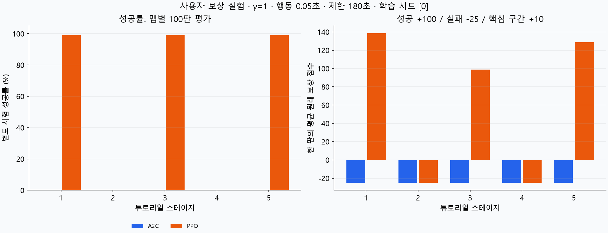
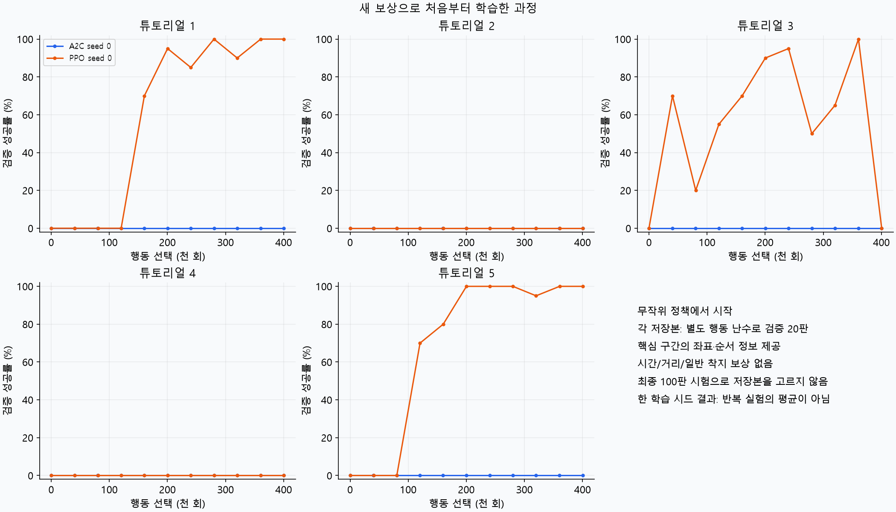
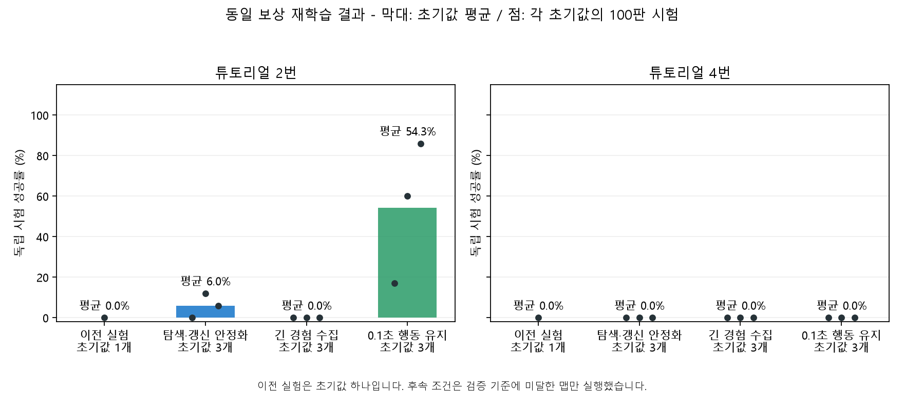

# 튜토리얼 1~5 강화학습 실험 정리

2026-10-30에 로컬에서 실행한 실험을 2026-11-01에 정리했다.
새 학습을 실행한 결과가 아니라 기존 모델·설정·평가 기록을 보존한 묶음이다.
`baseline`은 1~5의 A2C/PPO 비교, `recovery`는 이후 2·4의 PPO 조건 비교다.
저장소의 별도 `tutorial_2_4/` 실험과는 환경·보상·평가가 다를 수 있으므로 구분한다.

## 포함한 자료

| 위치 | 내용 |
|---|---|
| `baseline/results/` | A2C/PPO 각 5개 선택 모델, 설정·검증·최종 시험·학습 곡선 |
| `baseline/runtime/` | 그 모델을 학습한 고정 게임·학습 소스와 실행 자산 |
| `recovery/results/` | 3조건 × 2맵 × 3시드의 선택 모델 18개와 결과 |
| `recovery/runtime/` | 재학습 당시 고정 소스와 실행 자산 |
| `models.json` | 절대 경로에 의존하지 않는 모델 목록·SHA-256·평가 결과 |
| `results.csv` | 선택 모델 28개의 독립 시험 성공률 표 |
| `archive_manifest.json` | 업로드 묶음의 파일별 SHA-256 |
| `provenance/` (각 실험 내부) | 당시 버전·원래 런타임 기록 |

초기·마지막·주기별 중복 체크포인트, 임시 콘솔 로그, 캐시, 전체 학습 에피소드 JSONL은
이 묶음에서 제외했다. 원본 로컬 `output` 자료는 삭제하거나 바꾸지 않았다.
원래 설정의 `sources`에 기록된 파일과 필요한 의존 소스는 바이트 그대로 보존했다.
고정 소스의 과거 영어 주석도 해시 보존을 위해 수정하지 않았다. 현재 `rl/` 코드는 한글 주석이다.
두 런타임의 중복 자산은 Git에서 동일한 내용의 객체로 공유된다.

## 1~5 A2C/PPO 비교 결과

검증에서 선택한 저장본을 맵마다 독립 시험 100판으로 평가했다. 학습 시드는 0 하나다.

| 튜토리얼 | A2C | PPO |
|---|---:|---:|
| 1 | 0/100 | 99/100 |
| 2 | 0/100 | 0/100 |
| 3 | 0/100 | 99/100 |
| 4 | 0/100 | 0/100 |
| 5 | 0/100 | 99/100 |





[상세 보고서](baseline/results/결과보고서.md) · [학습 설정](baseline/results/plan.json)

3번 성공 99판 중 98판은 핵심 구간 보상 없이 이글루에 도착했다.
성공률이 높다는 사실만으로 의도한 이동 발판 경로를 충분히 학습했다고 해석하면 안 된다.
2·4번이 교사 검증 기준 80%에 미달해 정책 증류·통합 PPO는 실행하지 않았다.
이 묶음에는 5개 맵을 해결하는 단일 통합 정책이 없다.

## 2·4 후속 실험

| 조건 | 2번: 시드 0 / 1 / 2 | 2번 평균 | 4번 평균 |
|---|---|---:|---:|
| 갱신 안정화 | 0% / 12% / 6% | 6.0% | 0% |
| 긴 경험 수집 | 0% / 0% / 0% | 0% | 0% |
| 0.1초 행동 유지 | 17% / 60% / 86% | 54.3% | 0% |

각 모델의 최종 시험은 100판이다. 모델 선택용 별도 검증 50판과 구분한다.
2번은 개선됐지만 시드 편차가 크고, 이 로컬 후속 실험의 4번은 해결되지 않았다.
이 결과를 저장소에 별도로 올라온 `tutorial_2_4/`의 결과와 섞지 않는다.



[후속 실험 보고서](recovery/results/결과보고서.md) · [후속 학습 곡선](recovery/results/learning_curves.png)

## 보상·관측·행동

행동은 좌(-1)·무입력(0)·우(+1)의 3개다. 에이전트는 현재 공의 위치·속도·상태,
맵의 블록·이동 범위·시간 블록 위상·이글루, 남은 시간과 핵심 구간 상태를 관측한다.
사람이 작성한 정답 행동이나 시간표를 제공하지 않는다. 핵심 구간의 중간 목표는 설계자가 지정했다.

- 이글루 도착 +100.
- 실패 또는 180초 제한 -25. 동시에 발생해도 한 번만 지급.
- 특수 블록에 실제 착지한 뒤 지정한 다음 발판 그룹에 최초 착지하면 +10.
- 같은 구간은 한 판에 한 번. 연결 이동 발판 안에서 움직인 것만으로는 지급하지 않음.
- 단순 이동·반동·생존은 0. 학습기로 전달하는 보상에만 0.01을 곱하고 보고서는 원점수를 사용.

## 주요 학습 변수

| 변수 | 1~5 A2C | 1~5 PPO | 2·4 후속 PPO |
|---|---|---|---|
| 할인율 gamma | 1.0 | 1.0 | 1.0 |
| 학습률 | 0.0003 | 0.0003 | 0.0001 |
| 환경 수 | 4 | 4 | 4 |
| 수집 길이 n_steps | 64 | 128 | 128 / 512 |
| GAE lambda | 0.98 | 0.98 | 0.98 / 0.995 |
| 배치 크기 | 전체 수집 256 | 256 | 256 |
| PPO 갱신 횟수 | 해당 없음 | 5 | 3 |
| PPO clip_range | 해당 없음 | 0.2 | 0.1 |
| PPO target_kl | 해당 없음 | 0.02 | 0.01 |
| 엔트로피 계수 | 0.02 → 0.005 → 0.001 | 동일 | 0.03, 성공률 기준 충족 후 0.01까지 감소 |
| 행동 유지 | 0.05초 | 0.05초 | 0.05 / 0.1초 |
| 원래 물리 | 120Hz | 120Hz | 120Hz |
| 학습량 | 모델당 목표 400,000 행동 전이 | 동일 | 모델당 목표 2,400,000 물리 틱 |

기본 학습·주 평가는 정책 확률에서 행동을 표본 추출한다. 95% greedy / 5% 랜덤 방식이 아니다.
최대확률 행동과 5% 무작위 입력은 별도 진단이며 주 평가 결과와 구분한다.
시드가 하나인 기본 실험과 세 개인 후속 실험의 평균을 같은 통계적 강도로 비교할 수 없다.
gamma=1.0과 신경망 학습률은 서로 다른 값이다. 학습률을 1.0으로 실행한 실험이 아니다.

## 설치·검증·재생

저장소 루트에서 Python 3.12 환경을 만들고 실행한다. 모델 호환 버전은 각 실험의
`provenance/versions.json`에 있다. 원래 실험은 CPU에서 실행했다.

```powershell
python -m venv .venv
.venv\Scripts\python.exe -m pip install -r requirements-rl.txt
.venv\Scripts\python.exe -B tools/tutorial_rl.py verify
.venv\Scripts\python.exe -B tools/tutorial_rl.py list
.venv\Scripts\python.exe -B tools/tutorial_rl.py play --stage 5 --algorithm ppo
.venv\Scripts\python.exe -B tools/tutorial_rl.py play --experiment recovery --stage 2 --variant hold --training-seed 2
```

macOS/Linux에서는 `.venv/Scripts/python.exe` 대신 `.venv/bin/python`을 사용한다.
재생은 기본적으로 정책 확률을 표본 추출한다. `--greedy`는 별도 최대확률 재생이다.
2·4 기본 모델과 후속 4번 모델은 실패 분석용이며 클리어를 보장하지 않는다.

```powershell
.venv\Scripts\python.exe -B tools/tutorial_rl.py smoke --output-dir output/rl_archive_checks
.venv\Scripts\python.exe -B tools/tutorial_rl.py evaluate --stage 5 --algorithm ppo --episodes 5 --output output/rl_eval_5.json
```

`smoke`는 저장본 로드·관측 규격·짧은 원래 물리 궤적 대조다. 성공률 시험이 아니다.
`evaluate`는 새 행동 난수로 추가 평가하므로 보존된 100판 결과와 숫자가 다를 수 있다.
과거 JSON의 절대 경로는 당시 기록으로 보존했고 실행은 `models.json`의 상대 경로로 찾는다.

## 새로 학습하기

현재 게임으로 새 학습을 시작하려면 루트에서 다음 명령을 사용한다.

```powershell
.venv\Scripts\python.exe -B -m rl.milestone_train --root output/new_tutorial_1_5 --expert-steps 400000 --seeds 0 --workers 3
```

학습량에 따라 오래 걸릴 수 있다. 기존 결과 폴더와 다른 출력 경로를 사용한다.
현재 게임 맵은 당시 고정 소스와 다를 수 있으므로 보존된 결과의 재생은 위 런처를 사용한다.
`baseline/runtime` 또는 `recovery/runtime`을 작업 디렉터리로 같은 명령을 실행하면
그때의 고정 소스에서 새로 학습할 수 있다. 출력은 별도의 절대 경로로 지정한다.
