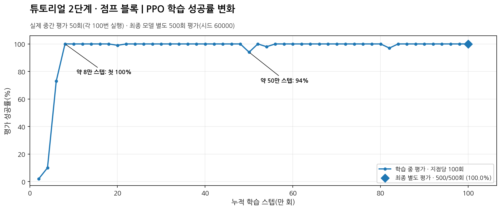
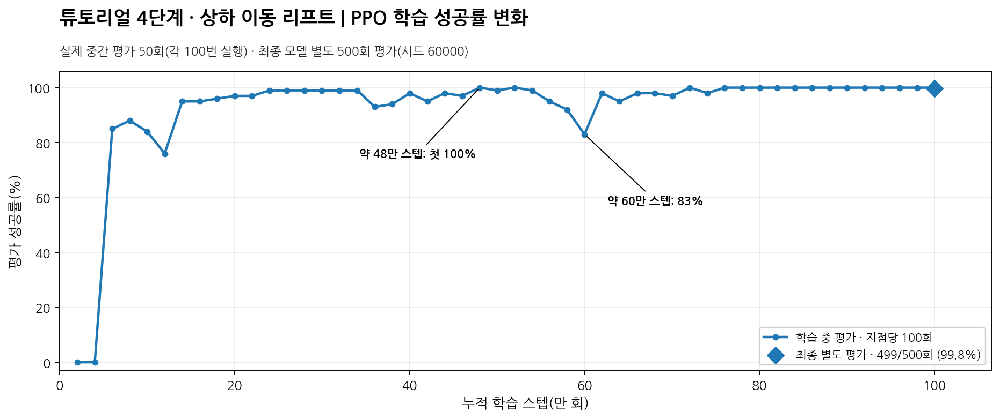

# 튜토리얼 2·4단계 PPO 강화학습

핑구볼 튜토리얼 2단계(점프 블록)와 4단계(상하 이동 리프트)를 PPO로 각각 처음부터 100만 스텝 학습했다. 원본 게임 물리 코드는 수정하지 않았으며 BC·DAgger·전문가 시연 데이터를 사용하지 않았다. 최종 모델은 각 500회, 시드 60000, 확률 선택 95%·최댓값 선택 5%로 평가했다.

## 1. 파일 및 폴더 안내

| 위치 | 역할 |
|---|---|
| `images/tutorial2.png` | 2단계 실제 학습 과정 평가 성공률 그래프 |
| `images/tutorial4.png` | 4단계 실제 학습 과정 평가 성공률 그래프 |
| `tutorial2/tutorial2_ppo_setting/` | 2단계 게임 환경·점프 보상·신경망·PPO 계산·화면 출력 코드 |
| `tutorial2/tutorial2_ppo_train.py` | 2단계 학습·평가·실행 확인용 코드 |
| `tutorial2/result_tutorial2/` | 2단계 최종 모델 및 학습 기록 |
| `tutorial2/tests/` | 2단계 보상·알고리즘·실행 코드 테스트 |
| `tutorial2/requirements_rl.txt` | 2·4단계 공통 강화학습 의존성 목록 |
| `tutorial4/tutorial4_ppo_setting/` | 4단계 게임 환경·리프트 보상·신경망·PPO 계산·화면 출력 코드 |
| `tutorial4/tutorial4_ppo_train.py` | 4단계 학습·평가·실행 확인용 코드 |
| `tutorial4/result_tutorial4/` | 4단계 최종 모델 및 학습 기록 |
| `tutorial4/tests/` | 4단계 보상·알고리즘·실행 코드 테스트 |

각 `result_tutorialN/` 폴더의 `last.pt`는 100만 스텝 최종 체크포인트, `best.pt`는 중간 평가 기준 최고 체크포인트다. `episodes.csv`는 학습 에피소드별 기록, `evaluations.csv`는 약 2만 스텝마다 100회씩 진행한 중간 평가 기록이다. `backup/`에는 이전 실험 및 최종 모델의 별도 백업 파일이 들어 있다. `pingu_ball/` 원본 게임 코드는 이 폴더 밖, 프로젝트 최상위에 그대로 있어야 한다.

## 2. 튜토리얼 2단계 — 점프 블록

### 2.1. 학습 규모와 PPO 설정

| 항목 | 설정 및 결과 |
|---|---|
| 학습 시작 | 무작위 초기화, 0스텝부터 학습 |
| 총 학습량 | 1,000,000 행동 선택 스텝 |
| 종료된 학습 에피소드 | 82,262회 |
| 누적 게임 물리 프레임 | 59,453,414프레임 |
| 학습 중 성공 / 실패 | 77,244회 / 5,018회 |
| 난수 시드 | 42 |
| 병렬 환경 수 / 환경당 수집 스텝 | 4개 / 128스텝 (수집당 512개) |
| 학습률 / 최적화 | 0.0003 고정 / Adam(ε=0.00001) |
| 할인율(γ) / 이점 추정 계수(λ) | 1.0 / 0.98 |
| PPO 클리핑 / 목표 KL | 0.15 / 0.03 |
| 미니배치 / PPO 반복 횟수 | 256개 / 최대 5회 |
| 탐색 장려 계수 | 0.02 → 0.001 (처음 30만 스텝 동안 선형 감소, 이후 고정) |
| 가치 손실 계수 / 기울기 제한 | 0.5 / 0.5 |
| 이점 정규화 / 학습 보상 조정 | 사용 / 보상 ÷ 25 |
| 신경망 / 관측값 차원 | 은닉층 128→128(Tanh) / 40차원 |
| 행동 / 물리 갱신 | 왼쪽·대기·오른쪽 × 12·30·72프레임 = 9개 행동 / 초당 120프레임 |
| 학습 행동 / 평가 행동 | 확률 선택 100% / 확률 선택 95% + 최댓값 선택 5% |
| 중간 평가 / 체크포인트 | 약 20,000스텝마다 100회 / 약 5,000스텝마다 저장 |
| 중간 평가 시드 / 제한 시간 | 50000 / 한 에피소드 최대 180초 |

### 2.2. 공통 보상

| 상황 | 보상 | 조건 |
|---|---:|---|
| 이글루 도착 | +100 | 클리어 시 한 번 |
| 낙하·충돌 실패 | -25 | 실패 시 한 번 |
| 시간 초과 | -25 | 180초 초과 시 한 번, 실패 벌점과 중복 없음 |
| 일반 이동·대기·자동 점프·생존 | 0 | 행동 자체에 보상 없음 |

### 2.3. 점프 블록 개별 보상

| 상황 | 보상 | 조건 |
|---|---:|---|
| 목표 발판 첫 착지 | +10 | 점프 블록 반동 후 3초 안에 지정된 목표 발판에 착지 |
| 목표 높이 첫 진입 | +0.5 | 반동 후 목표 발판 윗면 높이 ±16px에 처음 진입 |
| 목표 가로 범위 첫 진입 | +0.5 | 반동 후 목표 발판 가로 범위에 처음 겹침 |

1번 점프 블록은 중간 발판, 2번은 상단 발판, 3번은 결승 발판이 목표다. 보상은 같은 점프 블록에 대해 에피소드당 한 번씩 지급하며, 개별 보상 최대 +33점과 클리어 +100점을 합하면 최대 +133점이다. 이전 실험의 점프 블록 첫 착지 +12점, 추가 클리어 +18점, 오른쪽 진행 보상은 사용하지 않았다.

### 2.4. 최종 평가와 학습 그래프

| 평가 항목 | 결과 |
|---|---:|
| 최종 모델 | `tutorial2/result_tutorial2/last.pt` |
| 별도 평가 조건 | 500회, 시드 60000, 혼합 정책 95:5 |
| 최종 성공 / 실패 | 500회 / 0회 |
| 최종 성공률 | 100.0% |
| 점프 블록 1·2·3 도달률 | 각각 100% |
| 중간·상단·결승 발판 도달률 | 각각 100% |
| 평균 플레이 시간 / 평균 보상 | 6.12초 / 133.00점 |
| 평균 최대 가로 좌표 | 1326.1 |
| 왼쪽 / 대기 / 오른쪽 행동 비율 | 25.0% / 0.0% / 75.0% |



가로축은 누적 학습 스텝(만 회), 세로축은 중간 평가 성공률(%)이다. 실제 중간 평가 50회(지점마다 100판)를 연결했으며 맨 오른쪽 마름모는 최종 500판 별도 평가다. 80,384스텝에 첫 100%를 기록했고, 500,224스텝에서 94%, 820,224스텝에서 97%로 일시 하락한 뒤 회복했다. 학습 중 실패는 총 5,018회로 모두 얼음 바다 낙하였다. 최종 500회에서는 실패가 없었지만, 다른 맵에서도 무조건 성공한다는 의미는 아니다.

### 2.5. 확인할 부분

점프 보상은 왼쪽·오른쪽 방향을 제한하지 않지만 현재 관측값은 2단계 전용 40차원이며, 다음 목표 발판도 2단계 지형에 맞게 지정돼 있다. 일반 스테이지에 적용하려면 목표 발판 연결과 관측 구조를 새 맵에 맞게 설계해야 한다. 학습 CSV만으로 중간 실패의 정확한 좌표나 원인을 단정할 수 없다.

## 3. 튜토리얼 4단계 — 상하 이동 리프트

### 3.1. 학습 규모와 PPO 설정

| 항목 | 설정 및 결과 |
|---|---|
| 학습 시작 | 무작위 초기화, 0스텝부터 학습 |
| 총 학습량 | 1,000,000 행동 선택 스텝 |
| 종료된 학습 에피소드 | 26,613회 |
| 누적 게임 물리 프레임 | 39,965,516프레임 |
| 학습 중 성공 / 낙하 / 시간 초과 | 21,777회 / 4,806회 / 30회 |
| 난수 시드 | 42 |
| 병렬 환경 수 / 환경당 수집 스텝 | 4개 / 128스텝 (수집당 512개) |
| 학습률 / 최적화 | 0.0003 고정 / Adam(ε=0.00001) |
| 할인율(γ) / 이점 추정 계수(λ) | 1.0 / 0.98 |
| PPO 클리핑 / 목표 KL | 0.15 / 0.03 |
| 미니배치 / PPO 반복 횟수 | 256개 / 최대 5회 |
| 탐색 장려 계수 | 0.02 → 0.001 (처음 30만 스텝 동안 선형 감소, 이후 고정) |
| 가치 손실 계수 / 기울기 제한 | 0.5 / 0.5 |
| 이점 정규화 / 학습 보상 조정 | 사용 / 보상 ÷ 25 |
| 신경망 / 관측값 차원 | 은닉층 128→128(Tanh) / 36차원 |
| 행동 / 물리 갱신 | 왼쪽·대기·오른쪽 × 12·30·72프레임 = 9개 행동 / 초당 120프레임 |
| 학습 행동 / 평가 행동 | 확률 선택 100% / 확률 선택 95% + 최댓값 선택 5% |
| 중간 평가 / 체크포인트 | 약 20,000스텝마다 100회 / 약 5,000스텝마다 저장 |
| 중간 평가 시드 / 제한 시간 | 50000 / 한 에피소드 최대 180초 |

### 3.2. 공통 보상

| 상황 | 보상 | 조건 |
|---|---:|---|
| 이글루 도착 | +100 | 클리어 시 한 번 |
| 낙하·충돌 실패 | -25 | 실패 시 한 번 |
| 시간 초과 | -25 | 180초 초과 시 한 번, 실패 벌점과 중복 없음 |
| 일반 이동·대기·자동 점프·생존 | 0 | 행동 자체에 보상 없음 |

### 3.3. 리프트·구간 달성 보상

| 상황 | 보상 | 조건 |
|---|---:|---|
| 리프트 최초 착지 | +12 | 실제 리프트에 최초 착지 |
| 리프트 높은 위치 활용 | +12 | 리프트 이용 후 높이·근접·최근 착지 조건을 모두 만족 |
| 상단 발판 최초 도착 | +10 | 리프트 이용 후 상단 결승 발판에 처음 착지하는 구간 달성 보상 |
| 상단 발판 추가 보상 | +18 | 위 구간 달성과 별도로 한 번 지급 |
| 리프트 방향 첫 접근 | 1px당 +0.045 | 처음 도달한 가로 좌표만 보상하며 누적 최대 +12.96 |

반복 착지로 +12·+18을 여러 번 지급하지 않는다. 구간 달성 +10을 포함한 리프트·접근 보상 합계는 최대 +64.96점이며, 클리어 보상까지 합하면 이론적 최대 +164.96점이다. 오른쪽 가로 접근 보상은 4단계 지형 전용이며 일반 스테이지에 그대로 사용하면 안 된다.

### 3.4. 최종 평가와 학습 그래프

| 평가 항목 | 결과 |
|---|---:|
| 최종 모델 | `tutorial4/result_tutorial4/last.pt` |
| 별도 평가 조건 | 500회, 시드 60000, 혼합 정책 95:5 |
| 최종 성공 / 낙하 실패 | 499회 / 1회 |
| 최종 성공률 | 99.8% |
| 리프트 최초 착지·높은 위치 활용 | 각각 99.8% |
| 상단 발판·구간 달성률 | 각각 99.8% |
| 평균 플레이 시간 / 평균 보상 | 9.48초 / 164.61점 |
| 평균 최대 가로 좌표 | 977.9 |
| 왼쪽 / 대기 / 오른쪽 행동 비율 | 27.1% / 11.6% / 61.3% |



가로축은 누적 학습 스텝(만 회), 세로축은 중간 평가 성공률(%)이다. 480,256스텝에 첫 100%를 기록한 뒤 600,064스텝에서 83%로 하락했으며, 그 지점의 평균 플레이 시간은 112.05초, 리프트 도달률은 100%였다. 이후 회복해 760,320스텝 이후 13개 연속 중간 평가가 100%였다. 최종 500회에서 1회 낙하 실패했으나 CSV에 좌표가 없어 실패 위치를 특정할 수 없다.

### 3.5. 확인할 부분

리프트에 도달했어도 오랫동안 움직이지 못할 수 있다. 별도 시간 벌점이 없고 할인율이 1.0이므로 학습 중 대기가 길어지는 경우가 나타날 수 있다. 현재 36차원 관측값과 접근 보상은 4단계 전용이며, 다른 스테이지에서 동일한 성능을 보장하지 않는다.

## 4. 실행 방법

명령어는 원본 Git 프로젝트 최상위 폴더(`pingu_ball/`이 있는 위치)에서 실행한다. 게임을 실행하려면 원본 `pingu_ball/`과 `assets/`가 필요하다. 아래 명령은 최종 체크포인트를 읽기만 하며 모델을 변경하지 않는다.

```bat
python tutorial_2_4\tutorial2\tutorial2_ppo_train.py evaluate --trials 500 --seed 60000
python tutorial_2_4\tutorial4\tutorial4_ppo_train.py evaluate --trials 500 --seed 60000
```

새로 학습할 때는 최종 모델을 덮어쓰지 않도록 기본 저장 경로가 `result_tutorial2_new/`, `result_tutorial4_new/`로 분리돼 있다. 0부터 100만 스텝을 학습하려면 아래 명령을 사용한다.

```bat
python tutorial_2_4\tutorial2\tutorial2_ppo_train.py train --steps 1000000
python tutorial_2_4\tutorial4\tutorial4_ppo_train.py train --steps 1000000
```

실행 확인(학습 없이 몇 판 진행):

```bat
python tutorial_2_4\tutorial2\tutorial2_ppo_train.py smoke --episodes 5
python tutorial_2_4\tutorial4\tutorial4_ppo_train.py smoke --episodes 5
```

단위 테스트:

```bat
python -m unittest discover -s tutorial_2_4\tutorial2\tests -p "test_*.py"
python -m unittest discover -s tutorial_2_4\tutorial4\tests -p "test_*.py"
```

두 단계의 공통 의존성은 `tutorial_2_4/tutorial2/requirements_rl.txt`에 적혀 있다. 로컬에 설치되지 않았다면 프로젝트의 가상환경에서 `python -m pip install -r tutorial_2_4/tutorial2/requirements_rl.txt`를 실행한다. 그래프는 제공된 학습 기록으로 이미 생성된 이미지이며 `plot_ppo_learning.py`는 요청대로 포함하지 않았다. 최종 모델의 체크포인트 내부 기록에는 실험 당시의 오래된 식별 문자열이 남아 있을 수 있으나, 호환성과 재학습 정보를 보존하기 위해 변경하지 않았다.
